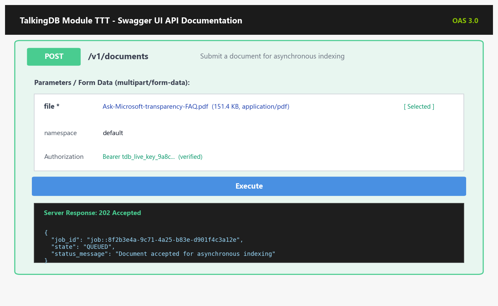
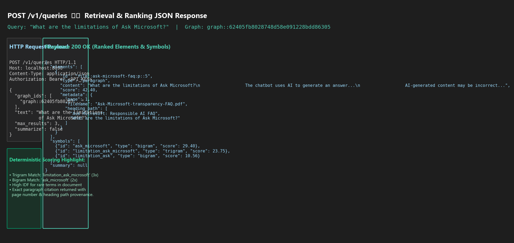

<p align="center">
  
</p>

# Text-to-Tree (TTT)

TTT turns a PDF or Word file into a **tree** of its own sections, paragraphs and table cells, indexes that tree by its words, and answers a question with the exact passages that match, each with its page and heading path. No [embeddings](https://en.wikipedia.org/wiki/Word_embedding), no guessing: every result can be traced back to the place in the document it came from.

| Start here | Go deeper |
| :--- | :--- |
| [How it works](#how-it-works) | [Concepts: tree, symbols, scoring, in plain words](docs/concepts.md) |
| [Run it in four steps](#run-it-in-four-steps) | [Every endpoint](docs/api-reference.md) |
| [What TTT is not](#what-ttt-is-not) | [All documentation](docs/README.md) |
| [Live API docs](https://ttt-rc4.talkingdb.io/docs) | [Troubleshooting](docs/troubleshooting.md) |

## How it works

<picture>
  <source media="(prefers-color-scheme: dark)" srcset="docs/images/how-ttt-turns-a-document-into-answers-dark.svg">
  
</picture>

<sub>Diagram source: [how-ttt-turns-a-document-into-answers.mmd](docs/diagrams/how-ttt-turns-a-document-into-answers.mmd). Edit it and re-render with the steps in [docs/diagrams](docs/diagrams/README.md).</sub>

In words: TTT keeps the document's own structure, indexes it by the words and phrases it contains, and answers by matching the question's words against that index, so each answer points to a real place in the file. The ideas behind each step are explained in [docs/concepts.md](docs/concepts.md).

## Run it in four steps

**1. Start the service** ([Docker](https://docs.docker.com/get-started/docker-overview/); data survives restarts in the `ttt-data` volume):

```bash
docker run -d --name talkingdb-ttt -p 8090:8090 -v ttt-data:/app/data talkingdb/ttt
```

Check `http://localhost:8090/health`, or open the API page at `http://localhost:8090/docs`. To get an API key, sign up and log in, then `POST /auth/api-keys` ([how](docs/api-reference.md#get-an-api-key)).

**2. Upload a document.** You get a `job_id` back at once (`202 Accepted`).

```bash
curl -X POST http://localhost:8090/v1/documents -H "Authorization: Bearer $TDB_API_KEY" -F "file=@report.pdf"
```



**3. Wait until it is indexed.** Poll the job until `state` is `COMPLETED`, then copy `result_graph_id`.

```bash
curl http://localhost:8090/v1/jobs/$JOB_ID -H "Authorization: Bearer $TDB_API_KEY"
```


**4. Ask a question.**

```bash
curl -X POST http://localhost:8090/v1/queries -H "Authorization: Bearer $TDB_API_KEY" -H "Content-Type: application/json" \
  -d '{"graph_ids": ["'$GRAPH_ID'"], "text": "What are the limitations of the system?", "max_results": 3}'
```



From Python, [sdk-talkingdb](https://github.com/TalkingDB/sdk-talkingdb) does steps 2 to 4 in two calls. If anything fails, see [troubleshooting](docs/troubleshooting.md).

## What TTT Is Not

- **Not a [vector database](https://en.wikipedia.org/wiki/Vector_database).** It scores word overlap in the document graph; no embeddings are stored or compared.
- **Not an answer generator.** Retrieval needs no language model. An [LLM](https://en.wikipedia.org/wiki/Large_language_model) is used only when you ask for `"summarize": true`, and only to summarise passages already retrieved ([details](docs/retrieval-and-demonstrations.md)).
- **Not [OCR](https://en.wikipedia.org/wiki/Optical_character_recognition).** Scanned PDFs without a text layer are rejected; run OCR first.
- **Not for every file type.** `.pdf` (up to 100 MB) and `.docx` (up to 50 MB) only.
- **Not an entity linker.** Mapping words to known entities is [package-named-entity-linker](https://github.com/TalkingDB/package-named-entity-linker) and [package-parse-tree](https://github.com/TalkingDB/package-parse-tree).

## Documentation

| Read this | When you want to |
| :--- | :--- |
| [Concepts](docs/concepts.md) | Understand elements, the tree, symbols, [IDF](https://en.wikipedia.org/wiki/Tf%E2%80%93idf) and scoring |
| [Ingestion pipeline](docs/ingestion-pipeline.md) | Know what happens between upload and `COMPLETED` |
| [Symbolic indexing](docs/symbolic-indexing.md) | See exactly how text becomes symbols and how scores are computed |
| [Table extraction](docs/table-extraction.md) | Query tables down to a single cell |
| [Retrieval and demonstrations](docs/retrieval-and-demonstrations.md) | See real requests, responses and summaries |
| [Fulfillment chat integration](docs/fulfillment-chat-integration.md) | Build a chat app or agent on top of TTT |
| [TTT vs. chunking](docs/chunking-comparison.md) | Compare with fixed, recursive and semantic chunking |
| [API reference](docs/api-reference.md) | Find any endpoint |
| [Troubleshooting](docs/troubleshooting.md) | Fix a problem |

## Related Repositories

| Repository | Role |
| :--- | :--- |
| [package-content-elementizer](https://github.com/TalkingDB/package-content-elementizer) | Reads PDF and DOCX into elements |
| [base-tdb-models](https://github.com/TalkingDB/base-tdb-models), [base-tdb-helpers](https://github.com/TalkingDB/base-tdb-helpers), [base-tdb-clients](https://github.com/TalkingDB/base-tdb-clients) | Document and graph models, job store, [SQLite](https://www.sqlite.org/about.html) and [MinIO](https://en.wikipedia.org/wiki/MinIO) |
| [sdk-talkingdb](https://github.com/TalkingDB/sdk-talkingdb) | Python client for this API |
| [flowbot-chatbot-ttt](https://github.com/TalkingDB/flowbot-chatbot-ttt) | The chat front end that answers from TTT |
| [infra-tdb-platform](https://github.com/TalkingDB/infra-tdb-platform) | Local setup and deployment |
| [talkingdb-benchmarks](https://github.com/TalkingDB/talkingdb-benchmarks) | Public benchmarks run with TTT |

## License

Licensed under the GNU Affero General Public License v3.0 ([AGPL-3.0](https://www.gnu.org/licenses/agpl-3.0.html)). See [LICENSE](LICENSE).
