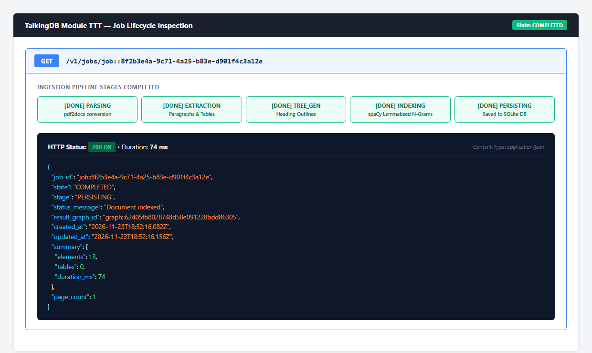
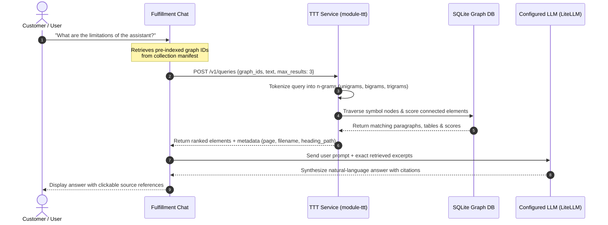

# Text-to-Tree (TTT)

TTT is a TalkingDB document ingestion and retrieval service that transforms PDF and DOCX files into structured, searchable graphs. Rather than dividing documents into arbitrary token chunks with opaque vector embeddings, TTT preserves document sections, headings, paragraphs, tables, rows and individual cells as interconnected graph elements indexed by deterministic symbols.

TTT is a **document processing and retrieval service**. It is not an application's general-purpose database and does not store or manage primary application business data.

[Interactive API Docs](https://ttt-rc4.talkingdb.io/docs) · [Quickstart Guide](https://docs.talkingdb.io/doc/quickstart-EHLtsm5kYD) · [Troubleshooting Guide](TROUBLESHOOTING.md)

---

## What TTT Does


1. **Ingests documents:** Accepts `.pdf` and `.docx` uploads via `POST /v1/documents` and queues a background processing job (`QUEUE_CAPACITY = 10`, file limits: 100 MB for PDF, 50 MB for DOCX).
2. **Parses layout and structure:** Uses [package-content-elementizer](https://github.com/TalkingDB/package-content-elementizer) to extract headings, paragraphs, tables, rows and cells with page coordinates and hierarchical heading paths.
3. **Builds a section tree:** Structures the document into an outline hierarchy (`FileIndexModel`) connected by directed `part_of` edges.
4. **Constructs an element graph:** Represents every paragraph, table, table row and table cell as a discrete graph node.
5. **Generates symbolic indexes:** Normalizes text into lemmatized unigrams, bigrams and trigrams, connecting symbols to source elements with `contains` and `context` edges.
6. **Retrieves evidence deterministically:** Scores and ranks matching elements using weighted n-grams and inverse document frequency (IDF) scoring, with optional LLM answer summarization.

---

## TTT vs. Conventional Chunking Strategies

| Chunking Strategy | How It Works | Relationship to TTT |
|---|---|---|
| [Fixed-size chunking](https://www.pinecone.io/learn/chunking-strategies/) | Splits text at fixed token or character intervals, often with overlapping windows. | **Different.** Fixed chunking breaks sentences and severs table rows. TTT preserves semantic element boundaries (paragraphs, rows, cells). |
| [Recursive chunking](https://weaviate.io/blog/chunking-strategies-for-rag) | Splits iteratively using separators such as double newlines, single newlines and spaces. | **Partial overlap.** Recursive chunking splits text on delimiters but lacks graph relations and section ancestry. |
| [Structure-aware chunking](https://weaviate.io/blog/chunking-strategies-for-rag) | Respects document markup (headings, paragraphs, tables, lists). | **Closest to TTT.** TTT preserves section hierarchy and isolates tables, rows and cells as searchable nodes. |
| [Semantic chunking](https://www.pinecone.io/learn/chunking-strategies/) | Computes vector embeddings across sentences and splits when similarity falls below a threshold. | **Not used.** TTT relies on structural document boundaries rather than sliding similarity thresholds. |
| [Parent-child chunking](https://weaviate.io/blog/chunking-strategies-for-rag) | Indexes small child chunks for retrieval while returning larger parent context. | **Supported via graph.** TTT maintains explicit `part_of` edges from cells to rows, rows to tables, and paragraphs to section headings. |
| [Contextual / LLM chunking](https://www.pinecone.io/learn/chunking-strategies/) | Prompts an LLM to prepend document summary or situational context to each chunk. | **Not used during ingestion.** TTT captures deterministic structural context (heading path, page, table headers) without LLM overhead. |
| **TTT Symbolic Graph Indexing** | Parses elements, builds a [NetworkX](https://networkx.org/documentation/stable/tutorial.html) directed graph, extracts lemmatized n-grams, and scores with weighted [IDF](https://scikit-learn.org/stable/modules/feature_extraction.html#tfidf-term-weighting). | **The TTT Approach.** Provides deterministic retrieval with full provenance (filename, page number, heading path, row and column coordinates). |

---

## How Symbolic Indexing Works

A [noun phrase](https://dictionary.cambridge.org/grammar/british-grammar/noun-phrases) in grammar is a word or phrase naming a person, place, or concept (e.g., `network access policy`). While indexed terms frequently look like noun phrases, **TTT does not execute a grammatical noun phrase parser**.

Instead, TTT implements **adjacent word n-gram indexing** with [spaCy](https://spacy.io/usage/linguistic-features#tokenization) lemmatization:

```
"Network access policy controls customer authentication."
                           │
                           ▼
[1. Tokenization & Lemmatization] (app/services/package_text_tokenizer.py)
Tokens: ['network', 'access', 'policy', 'control', 'customer', 'authentication']
                           │
                           ▼
[2. N-Gram Symbol Generation] (app/services/package_symbol_generator.py)
```

| Symbol Type | Definition | Generated Example Symbols | Weight (`GRAM_WEIGHTS`) |
|---|---|---|---|
| [Unigram](https://developers.google.com/machine-learning/glossary#n-gram) | Single normalized token | `network`, `access`, `policy`, `control`, `customer`, `authentication` | `1.0` |
| [Bigram](https://developers.google.com/machine-learning/glossary#bigram) | Two adjacent tokens | `network_access`, `access_policy`, `policy_control`, `control_customer`, `customer_authentication` | `2.0` |
| [Trigram](https://developers.google.com/machine-learning/glossary#trigram) | Three adjacent tokens | `network_access_policy`, `access_policy_control`, `policy_control_customer`, `control_customer_authentication` | `3.0` |

### Key Technical Distinctions
- **[Tokenization](https://spacy.io/usage/linguistic-features#tokenization):** Text is converted to lowercase and segmented into words.
- **[Lemmatization](https://spacy.io/usage/linguistic-features#lemmatization):** Words are reduced to base dictionary forms (e.g., `policies` &rarr; `policy`, `controls` &rarr; `control`).
- **[Stop Words](https://spacy.io/usage/linguistic-features#language-data):** Common prose words (`the`, `is`, `with`, `and`) are filtered from prose paragraphs.
- **Structured Tokenizer (`tokenize_structured`):** For tables, numeric values, years and specific labels are preserved so dates, prices, and reference codes remain fully searchable.
- **[Directed Graph](https://networkx.org/documentation/stable/tutorial.html) & [Edges](https://networkx.org/documentation/stable/tutorial.html):** Symbol nodes connect to document elements via `contains` edges (direct match, weight `1.0`) and `context` edges (inherited table context, weight `0.4`).
- **[IDF Scoring](https://scikit-learn.org/stable/modules/feature_extraction.html#tfidf-term-weighting):** Matches are scaled by inverse document frequency `log(total_elements / element_count)` so distinctive terms rank higher than frequent terms.


---

## Real Ingestion & Retrieval Demonstrations

The examples below were executed directly against real documents in this repository.

### Demonstration A: Paragraph & Section Extraction

**Document:** [Ask-Microsoft-transparency-FAQ.pdf](tests/load-tests/assets/Ask-Microsoft-transparency-FAQ.pdf) (151 KB)

#### 1. Document Submission
Submitted via `POST /v1/documents` as `multipart/form-data`:


**Response (`202 Accepted`):**
```json
{
  "job_id": "job::8f2b3e4a-9c71-4a25-b83e-d901f4c3a12e",
  "state": "QUEUED",
  "status_message": "Document accepted for asynchronous indexing"
}
```

#### 2. Ingestion Progress & Completion
Polled via `GET /v1/jobs/{job_id}` through the ingestion lifecycle:



**Response (`200 OK`):**
```json
{
  "job_id": "job::8f2b3e4a-9c71-4a25-b83e-d901f4c3a12e",
  "state": "COMPLETED",
  "stage": "PERSISTING",
  "status_message": "Document indexed",
  "result_graph_id": "graph::62405fb8028748d58e091228bdd86305",
  "summary": {
    "elements": 13,
    "tables": 0,
    "duration_ms": 74
  },
  "page_count": 1
}
```

#### 3. Section Hierarchy & Graph Structure
Inspected via `GET /v1/tree/json?graph_id=graph::62405fb8028748d58e091228bdd86305`:


The resulting graph contains **442 nodes** and **510 directed edges**, linking the file root (`file@root`), headings (H1, H2), and paragraph elements with their respective heading paths.

#### 4. Query Retrieval Output
Sent query via `POST /v1/queries`:

```json
{
  "graph_ids": ["graph::62405fb8028748d58e091228bdd86305"],
  "text": "What are the limitations of Ask Microsoft?",
  "max_results": 3,
  "summarize": false
}
```


**Actual Response (`200 OK`):**
```json
{
  "elements": [
    {
      "id": "file::ask-microsoft-faq:p::5",
      "type": "paragraph",
      "content": "What are the limitations of Ask Microsoft? How can users minimize the impact of Ask Microsoft’s limitations when using the system? The chatbot uses AI to generate an answer for the user prompts. AI-generated content may be incorrect. Please make sure to read through the citation links provided along with the AI response or contact the sales team for more information by prompting “chat with sales”. The chatbot is primarily trained on English (U.S.) text. Any other language or English variations may not be accurate.",
      "score": 42.40,
      "metadata": {
        "page": 1,
        "filename": "Ask-Microsoft-transparency-FAQ.pdf",
        "heading_path": [
          "Ask Microsoft: Responsible AI FAQ",
          "What are the limitations of Ask Microsoft?"
        ]
      }
    }
  ],
  "symbols": [
    { "id": "ask_microsoft", "type": "bigram", "score": 29.40 },
    { "id": "limitation_ask_microsoft", "type": "trigram", "score": 23.75 },
    { "id": "limitation_ask", "type": "bigram", "score": 10.56 }
  ],
  "summary": null
}
```

---

### Demonstration B: Structured Table Extraction

**Document:** `operational-audit-index.pdf` (Multi-Column Compliance and Audit Index)

Tables present a major challenge for standard RAG because dividing rows into arbitrary text chunks destroys relational column bindings. TTT parses tables into individual `table_row` and `table_cell` nodes, preserving row headers, column headers, and numerical tokens.

#### Source Document Content vs. TTT Graph Representation

| Source Document Content | TTT Extracted Representation | Extracted Values from Test Document |
|---|---|---|
| **Table Title / Caption** | Table Node (`type: table`) | `Operational Audit Report Index` (`audit:table::1`) |
| **Column Headings** | Column Header Metadata | `Report Title`, `Report No`, `Event Date`, `Recommendation No`, `Recommendation Status`, `Implementer` |
| **Individual Data Rows** | Table Row Nodes (`type: table_row`) | Row 1: Audit of regional operational facility, report 10/2025 |
| **Individual Data Values** | Table Cell Nodes (`type: table_cell`) | `10/2025/01` (Rec No), `06/09/2024` (Date), `Operations Unit` (Implementer) |
| **Surrounding Section** | Heading Path & Context Metadata | Heading Path: `["Operational Audit Report Index"]` |
| **Source Location** | Page Metadata | `page: 1` |


#### Querying Extracted Tables

1. **Broad Query across Column and Row Labels:**
   - **Query:** `"operational audit recommendation Operations Unit"`
   - **Matched Element:** `table_row` (score: `12.44`), `table_cell` (score: `11.34`).
   - **Extracted Content:** `"Audit of regional operational facility | Implementer: Operations Unit"`
   - **Matched Symbols:** `operations_unit` (bigram, `24.07`), `operational` (unigram, `9.28`), `audit` (unigram, `9.28`).

2. **Specific Reference Code Retrieval:**
   - **Query:** `"recommendation 10/2025/01 date"`
   - **Top Matched Element:** `table_row` (score: `38.94`), `table_cell` (score: `37.43`).
   - **Extracted Content:** `"Audit of regional operational facility | Recommendation No: 10/2025/01 | Event Date: 06/09/2024"`
   - **Matched Symbols:** `10_2025_01` (trigram, `37.43`), `10_2025` (bigram, `28.90`), `2025_01` (bigram, `16.64`).

Because `tokenize_structured` preserves slashes, numbers and codes, exact reference tokens like `10/2025/01` achieve the highest trigram weight (`3.0`), retrieving the exact cell and row without hallucination.

---

## How Fulfillment Chat Uses TTT

Fulfillment Chat is an example integration pattern showing how an external customer application integrates TTT with a conversational LLM.



### Component Responsibilities

| Component | Responsibility |
|---|---|
| **Fulfillment Chat** | Manages user interface, conversation session history, authentication, and orchestrates calls between TTT and the LLM. |
| **TTT (`module-ttt`)** | Ingests documents, maintains section trees, builds symbolic index graphs, and retrieves grounded evidence with relevance scores. |
| **Language Model (LLM)** | Synthesizes a natural-language answer based strictly on retrieved excerpts. (Does not perform document indexing or search). |
| **Document Collection** | Source policy documents, user guides, or manuals uploaded and pre-indexed as stable graph IDs. |

---

## Managing Document Collections

Documents should be **uploaded and indexed once**. Ingestion returns a permanent `result_graph_id`. Applications store these graph IDs in a configuration file or collection manifest rather than uploading files on every user query.

### Static Collection Manifest Example
See [`examples/fulfillment-collection.json`](examples/fulfillment-collection.json):

```json
{
  "collection_name": "Fulfillment Knowledge Base",
  "documents": [
    {
      "name": "Fulfillment & Dispatch Policy",
      "filename": "fulfillment-policy.pdf",
      "graph_id": "graph::e1b4a7d290c8413f9a7218d6e35c8b01"
    },
    {
      "name": "Customer Returns & Refund Terms",
      "filename": "returns-policy.pdf",
      "graph_id": "graph::b49c017d83fa461298e1f0a25698dd34"
    }
  ]
}
```

### Multi-Graph Querying
Queries can span multiple document graphs in a single API call:

```bash
curl -X POST "http://localhost:8090/v1/queries" \
  -H "Authorization: Bearer YOUR_API_KEY" \
  -H "Content-Type: application/json" \
  -d '{
    "graph_ids": [
      "graph::e1b4a7d290c8413f9a7218d6e35c8b01",
      "graph::b49c017d83fa461298e1f0a25698dd34"
    ],
    "text": "What is the return window for damaged items?",
    "max_results": 5,
    "summarize": false
  }'
```

---

## Getting Started

### 1. Start the Service with Docker
```bash
docker pull talkingdb/ttt
docker run -d --name talkingdb-ttt -p 8090:8090 -v ttt-data:/app/data talkingdb/ttt
```

The named volume `ttt-data` preserves SQLite graph databases (`data/graphs.db`) across container restarts.

### 2. Verify Service Health
Open `http://localhost:8090/health` or check via command line:
```bash
curl http://localhost:8090/health
```

Interactive OpenAPI documentation is available at `http://localhost:8090/docs`.

### 3. Create an Account and API Key
In Swagger UI or via terminal, call:
```bash
# 1. Sign up
curl -X POST "http://localhost:8090/auth/signup" \
  -H "Content-Type: application/json" \
  -d '{"email": "developer@example.com", "password": "secure-password-123"}'

# 2. Login
curl -X POST "http://localhost:8090/auth/login" \
  -H "Content-Type: application/json" \
  -d '{"email": "developer@example.com", "password": "secure-password-123"}'
# (Copy the returned access_token)

# 3. Create API Key
curl -X POST "http://localhost:8090/auth/api-keys" \
  -H "Authorization: Bearer YOUR_ACCESS_TOKEN"
# (Copy the returned api_key)
```

Use the returned **API Key** as the `Bearer` token for all `/v1/*` endpoints.

### 4. Upload a Document
```bash
curl -X POST "http://localhost:8090/v1/documents" \
  -H "Authorization: Bearer YOUR_API_KEY" \
  -F "file=@tests/load-tests/assets/Ask-Microsoft-transparency-FAQ.pdf"
```
*Returns `202 Accepted` with a `job_id`.*

### 5. Poll Job Status
```bash
curl -X GET "http://localhost:8090/v1/jobs/YOUR_JOB_ID" \
  -H "Authorization: Bearer YOUR_API_KEY"
```
Wait until `state` transitions to `COMPLETED`, then copy `result_graph_id`.

### 6. Query the Document Graph
```bash
curl -X POST "http://localhost:8090/v1/queries" \
  -H "Authorization: Bearer YOUR_API_KEY" \
  -H "Content-Type: application/json" \
  -d '{
    "graph_ids": ["YOUR_GRAPH_ID"],
    "text": "What is Ask Microsoft?",
    "max_results": 5,
    "summarize": false
  }'
```

### 7. Inspect Document Hierarchy
Retrieve the section tree JSON:
```bash
curl -X GET "http://localhost:8090/v1/tree/json?graph_id=YOUR_GRAPH_ID" \
  -H "Authorization: Bearer YOUR_API_KEY"
```

Or view the interactive D3 graph visualization in a browser:
```text
http://localhost:8090/index/html?graph_id=YOUR_GRAPH_ID
```

### 8. Enable Optional LLM Summarization
Set environment variables before starting the container:
```bash
docker run -d --name talkingdb-ttt -p 8090:8090 \
  -e LLM_PROVIDER="openai" \
  -e OPENAI_API_KEY="sk-..." \
  -v ttt-data:/app/data talkingdb/ttt
```
Then pass `"summarize": true` in `POST /v1/queries`. The service routes summarization through [LiteLLM](https://docs.litellm.ai/).

---

## Main API Endpoints

| Method | Endpoint | Description |
|---|---|---|
| `GET` | `/health` | Service health status check |
| `POST` | `/auth/signup` | Register a new user account |
| `POST` | `/auth/login` | Authenticate and obtain JWT access token |
| `POST` | `/auth/api-keys` | Generate persistent API key for `/v1/*` endpoints |
| `GET` | `/v1/documents/constraints` | Get file type and size limits (100MB PDF, 50MB DOCX) |
| `POST` | `/v1/documents` | Submit a PDF or DOCX for asynchronous indexing |
| `GET` | `/v1/jobs/{job_id}` | Poll ingestion progress, status message, and graph ID |
| `POST` | `/v1/jobs/{job_id}/cancel` | Cancel an ongoing ingestion job |
| `POST` | `/v1/queries` | Search indexed document graphs and retrieve ranked elements |
| `GET` | `/v1/tree/json` | Export the document hierarchy outline as JSON |
| `GET` | `/index/html` | View interactive D3.js document graph |

---

## Related Repositories

- [package-content-elementizer](https://github.com/TalkingDB/package-content-elementizer): Document parsing engine that elementizes PDF and DOCX files.
- [base-tdb-models](https://github.com/TalkingDB/base-tdb-models): Shared data structures (`DocumentModel`, `GraphModel`, `FileIndexModel`, `ParagraphModel`, `TableModel`).
- [base-tdb-clients](https://github.com/TalkingDB/base-tdb-clients): SQLite and storage connection clients.
- [base-tdb-helpers](https://github.com/TalkingDB/base-tdb-helpers): Graph caching, auth verification, and file spooling utilities.
