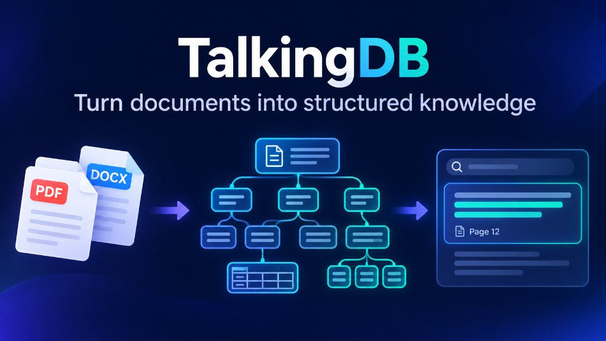
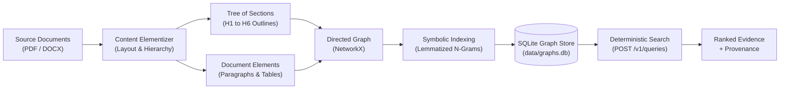

<p align="center">
  
</p>

# Text-to-Tree (TTT)
> Turn PDF & DOCX documents into structured, searchable knowledge graphs.

TTT is a TalkingDB document ingestion and retrieval service that transforms PDF and DOCX files into deterministic, queryable graphs. Rather than slicing documents into arbitrary token chunks with opaque vector embeddings, TTT preserves document sections, headings, paragraphs, and multi-column tables as interconnected graph elements indexed by normalized symbols.

TTT is a **document processing and retrieval service**. It is designed for applications (such as conversational agents and enterprise search) that require grounded evidence with full provenance, exact table cell queries, and zero vector hallucination.

[Interactive API Docs](https://ttt-rc4.talkingdb.io/docs) · [Quickstart Guide](https://docs.talkingdb.io/doc/quickstart-EHLtsm5kYD) · [Troubleshooting Guide](TROUBLESHOOTING.md)

---

## Architecture Overview



---

## Core Capabilities

- **Structural Parsing:** Uses `package-content-elementizer` to extract headings, paragraphs, and physical coordinates (page numbers, bounding boxes, reading order).
- **Document Hierarchy:** Builds an outline tree (`FileIndexModel`) linking sections (H1–H6) to their child paragraphs and tables via directed `part_of` edges.
- **Relational Table Decomposition:** Parses tables into discrete `table_row` and `table_cell` nodes, preserving column headers and numerical reference codes (`10/2025/01`).
- **Symbolic Graph Indexing:** Extracts lemmatized unigrams, bigrams, and trigrams with spaCy, connecting symbols to elements with `contains` (weight `1.0`) and `context` (weight `0.4`) edges.
- **Auditable Relevance Scoring:** Matches terms deterministically using weighted n-grams and inverse document frequency (IDF) without vector similarity drift.
- **One-Time Ingestion:** Index once into stable graph IDs; query across multiple document graphs in a single request.

---

## Quickstart

### 1. Start Service with Docker
```bash
docker pull talkingdb/ttt
docker run -d --name talkingdb-ttt -p 8090:8090 -v ttt-data:/app/data talkingdb/ttt
```
*Verify health at `http://localhost:8090/health` or view OpenAPI docs at `http://localhost:8090/docs`.*

### 2. Upload a Document
```bash
curl -X POST "http://localhost:8090/v1/documents" \
  -H "Authorization: Bearer YOUR_API_KEY" \
  -F "file=@sample-document.pdf"
```
*Returns `202 Accepted` with a `job_id`.*

### 3. Poll Ingestion Status
```bash
curl -X GET "http://localhost:8090/v1/jobs/YOUR_JOB_ID" \
  -H "Authorization: Bearer YOUR_API_KEY"
```
*Wait until `state` is `COMPLETED`, then copy the `result_graph_id`.*

### 4. Query the Document Graph
```bash
curl -X POST "http://localhost:8090/v1/queries" \
  -H "Authorization: Bearer YOUR_API_KEY" \
  -H "Content-Type: application/json" \
  -d '{
    "graph_ids": ["YOUR_GRAPH_ID"],
    "text": "What are the limitations of the system?",
    "max_results": 3,
    "summarize": false
  }'
```

---

## Documentation & Deep Dives

Detailed guides, mathematical specifications, and evidence-based demonstrations are available in the [`docs/`](docs/) directory:

| Guide | Description |
|---|---|
| [**Document Ingestion Pipeline**](docs/ingestion-pipeline.md) | File limits, background worker queue (`QUEUE_CAPACITY = 10`), and the 5 ingestion stages (`PARSING` &rarr; `PERSISTING`). |
| [**Symbolic Indexing & Graph Construction**](docs/symbolic-indexing.md) | N-gram weights (trigrams `3.0`, bigrams `2.0`, unigrams `1.0`), edge types, IDF formulas, and section tree inspection. |
| [**Structured Table Extraction**](docs/table-extraction.md) | How tables decompose into `table_row` and `table_cell` nodes, preserving column bindings and numerical tokens. |
| [**Retrieval & Real Demonstrations**](docs/retrieval-and-demonstrations.md) | Verified input-to-output test runs, ranked JSON outputs, score breakdowns, and optional LLM summarization. |
| [**Downstream Integration & Fulfillment Chat**](docs/fulfillment-chat-integration.md) | Sequence diagram showing how chat applications and agents consume TTT, plus static collection manifests. |
| [**TTT vs. Conventional Chunking**](docs/chunking-comparison.md) | Detailed comparison against fixed, recursive, semantic, and parent-child chunking strategies. |

---

## Main API Endpoints

| Method | Endpoint | Description |
|---|---|---|
| `GET` | `/health` | Service health status check |
| `POST` | `/auth/signup` | Register a new user account |
| `POST` | `/auth/login` | Authenticate and obtain JWT access token |
| `POST` | `/auth/api-keys` | Generate persistent API key for `/v1/*` endpoints |
| `GET` | `/v1/documents/constraints` | Get file type and size limits (100MB PDF, 50MB DOCX) |
| `POST` | `/v1/documents` | Submit a PDF or DOCX for asynchronous indexing |
| `GET` | `/v1/jobs/{job_id}` | Poll ingestion progress, status message, and graph ID |
| `POST` | `/v1/jobs/{job_id}/cancel` | Cancel an ongoing ingestion job |
| `POST` | `/v1/queries` | Search indexed document graphs and retrieve ranked elements |
| `GET` | `/v1/tree/json` | Export the document hierarchy outline as JSON |
| `GET` | `/index/html` | View interactive D3.js document graph in browser |

---

## Related Repositories

- [package-content-elementizer](https://github.com/TalkingDB/package-content-elementizer): Document parsing engine that elementizes PDF and DOCX files.
- [base-tdb-models](https://github.com/TalkingDB/base-tdb-models): Shared data structures (`DocumentModel`, `GraphModel`, `FileIndexModel`, `ParagraphModel`, `TableModel`).
- [base-tdb-clients](https://github.com/TalkingDB/base-tdb-clients): SQLite and storage connection clients.
- [base-tdb-helpers](https://github.com/TalkingDB/base-tdb-helpers): Graph caching, auth verification, and file spooling utilities.
