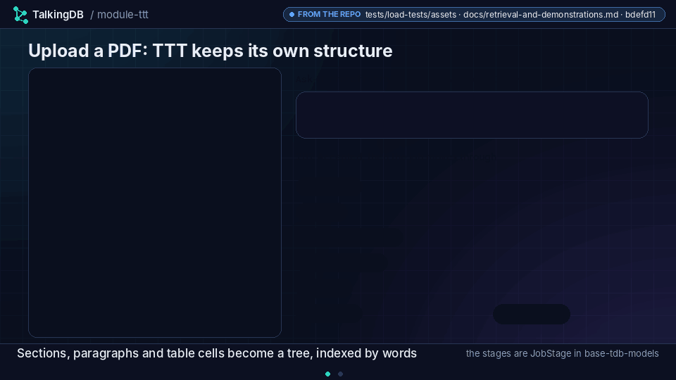

<!-- short-readme -->
<h1 align="center">Text-to-Tree (TTT)</h1>

<p align="center"><b>Ask your documents a question. Get the exact passage, its page and its heading.</b></p>

<p align="center"><a href="#try-it">Try it</a> · <a href="docs/concepts.md">Concepts</a> · <a href="docs/ingestion-pipeline.md">Ingestion pipeline</a> · <a href="docs/retrieval-and-demonstrations.md">Retrieval</a> · <a href="docs/table-extraction.md">Table extraction</a> · <a href="docs/reference.md">Full reference</a></p>

<p align="center"><a href="https://github.com/TalkingDB/module-ttt/stargazers"></a> <a href="https://www.gnu.org/licenses/agpl-3.0.html"></a></p>

<p align="center">
  
</p>
<p align="center"><sub>From the repo: the test PDF in <code>tests/load-tests/assets</code> and the actual query response in <a href="docs/retrieval-and-demonstrations.md">Retrieval and demonstrations</a>.</sub></p>

TTT turns a PDF or Word file into a **tree** of its own sections, paragraphs and table cells, indexes it by its words, and answers with the passages that match. No [embeddings](https://en.wikipedia.org/wiki/Word_embedding), no guessing: every answer points to a place you can check.

## What it does

- **Upload** a PDF or DOCX; you get a job id at once ([ingestion](docs/ingestion-pipeline.md)).
- **Ask** a question; get ranked passages with page, heading path and the words that scored them ([retrieval](docs/retrieval-and-demonstrations.md)).
- **Query tables** down to one cell ([tables](docs/table-extraction.md)).

## Try it

```bash
docker run -d --name talkingdb-ttt -p 8090:8090 -v ttt-data:/app/data talkingdb/ttt
curl -X POST localhost:8090/v1/documents -H "Authorization: Bearer $TDB_API_KEY" -F "file=@report.pdf"
```

Then poll the job and ask a question ([four steps](docs/reference.md#run-it-in-four-steps)); from Python, use [sdk-talkingdb](https://github.com/TalkingDB/sdk-talkingdb). Live API: [ttt-rc4.talkingdb.io/docs](https://ttt-rc4.talkingdb.io/docs).

## Where it fits

Reads files with [package-content-elementizer](https://github.com/TalkingDB/package-content-elementizer); answers [flowbot-chatbot-ttt](https://github.com/TalkingDB/flowbot-chatbot-ttt) and [sdk-talkingdb](https://github.com/TalkingDB/sdk-talkingdb).

## Learn more

| Page | Read it to |
| :--- | :--- |
| [Concepts](docs/concepts.md) | learn the ideas in plain words |
| [Ingestion pipeline](docs/ingestion-pipeline.md) | know what happens between upload and COMPLETED |
| [Retrieval](docs/retrieval-and-demonstrations.md) | see real requests and responses |
| [Table extraction](docs/table-extraction.md) | query a table down to one cell |
| [API reference](docs/api-reference.md) | find any endpoint |
| [Troubleshooting](docs/troubleshooting.md) | fix a problem |
| [Full reference](docs/reference.md) | read everything that used to be on this page |
| [All docs](docs/README.md) | see every page |

## Support TalkingDB

If TTT saved you time, please [give it a star](https://github.com/TalkingDB/module-ttt) ⭐. Stars help other developers find the project.

Found a bug, or a document it gets wrong? [Open an issue](https://github.com/TalkingDB/module-ttt/issues/new). We are always here to help and open to a conversation. Explore the TalkingDB applications at [talkingdb.io](https://talkingdb.io/#applications).

## License

Licensed under the GNU Affero General Public License v3.0 ([AGPL-3.0](https://www.gnu.org/licenses/agpl-3.0.html)). See [LICENSE](LICENSE).
