# Concepts

[Docs home](README.md) › Concepts

The ideas TTT is built on, one at a time, in plain words. Each section ends with where to read more.

## Element

An **element** is one block of a document: a paragraph, a table, one table row, or one table cell. Elements are what TTT returns as answers. They are produced by [package-content-elementizer](https://github.com/TalkingDB/package-content-elementizer), which reads PDF and DOCX files and keeps each block's page number and style (for example, Heading 2).

More: [ingestion pipeline](ingestion-pipeline.md).

## The tree

Documents already have a structure: chapters, sections, sub sections. TTT keeps it. Every paragraph and table is attached to the heading it sits under, and every heading to the heading above it, with a `part_of` link. That gives each passage a **heading path**, such as `Annual report › Risks › Supply chain`, which is returned with every answer.

<picture>
  <source media="(prefers-color-scheme: dark)" srcset="images/a-document-as-a-tree-dark.svg">
  
</picture>

<sub>Diagram source: [a-document-as-a-tree.mmd](diagrams/a-document-as-a-tree.mmd). Edit it and re-render with the steps in [docs/diagrams](diagrams/README.md).</sub>

In words: the file holds headings, headings hold paragraphs and tables, tables hold rows, rows hold cells, and every link points from the smaller part up to the bigger one.

More: [table extraction](table-extraction.md), [the tree endpoint](symbolic-indexing.md#5-document-section-hierarchy-tree).

## Symbols

To find passages without [embeddings](https://en.wikipedia.org/wiki/Word_embedding), TTT indexes the words. Text is split into words ([tokenization](https://spacy.io/usage/linguistic-features#tokenization)), each word is reduced to its dictionary form ([lemmatization](https://spacy.io/usage/linguistic-features#lemmatization): "policies" becomes "policy"), and common words like "the" are dropped. Then every one, two and three word run becomes a **symbol**:

| Kind | Example from "network access policy" |
| :--- | :--- |
| unigram (1 word) | `network`, `access`, `policy` |
| bigram (2 words) | `network_access`, `access_policy` |
| trigram (3 words) | `network_access_policy` |

Tables use a stricter tokenizer that keeps codes such as `10/2025/01` intact, so an exact reference can be found. Each symbol becomes a node in the graph, linked to every element that contains it.

More: [symbolic indexing](symbolic-indexing.md).

## Two kinds of links: contains and context

- **contains:** the symbol appears in the element's own text.
- **context:** for table rows, the symbol appears around the row: in the table's column headers or in the text that introduces the table. This is how "status of recommendation 10/2025/01" finds a row whose cells never say "status".

A context match counts for less: 0.4 of a direct match by default (`TDB_CONTEXT_MATCH_WEIGHT`).

## Scoring a passage

When a question arrives, it is turned into symbols the same way. Each element is scored by adding up, for every question symbol that links to it:

```text
score(element) = sum over n-gram sizes of  GRAM_WEIGHT(size) × sum over matching symbols of  IDF(symbol) × EDGE_WEIGHT
IDF(symbol)    = ln(1 + N / DF)      N  = number of elements in the document
                                     DF = number of elements that contain the symbol directly
```

| Part | Default | Set with |
| :--- | :--- | :--- |
| GRAM_WEIGHT unigram, bigram, trigram | 1, 4, 9 | `TDB_GRAM_WEIGHT_UNIGRAM`, `_BIGRAM`, `_TRIGRAM` |
| EDGE_WEIGHT contains, context | 1.0, 0.4 | `TDB_CONTEXT_MATCH_WEIGHT` |
| Rows or cells kept per table | 5 | `TDB_MAX_ROWS_PER_TABLE` |

Why it works: a rare word (low DF) gets a high [IDF](https://en.wikipedia.org/wiki/Tf%E2%80%93idf), so it matters more than a word that is everywhere; a matching phrase of three words counts far more than three separate words. The code is in [`app/services/extractor.py`](../app/services/extractor.py).

More: [symbolic indexing](symbolic-indexing.md#4-relevance-scoring--idf-mathematics), [retrieval](retrieval-and-demonstrations.md).

## Jobs: from upload to graph

Indexing a large file takes time, so uploads become background **jobs**. A job has a **state** (where it is in its life) and, while it runs, a **stage** (which step it is on).

<picture>
  <source media="(prefers-color-scheme: dark)" srcset="images/ttt-job-states-dark.svg">
  
</picture>

<sub>Diagram source: [ttt-job-states.mmd](diagrams/ttt-job-states.mmd). Edit it and re-render with the steps in [docs/diagrams](diagrams/README.md).</sub>

In words: a job waits, runs, and ends as completed, failed or cancelled; only a failed job can go back to the queue. While `ONGOING`, the stage moves through `PARSING`, `ELEMENT_EXTRACTION`, `TREE_GENERATION`, `INDEXING` and `PERSISTING`.

More: [ingestion pipeline](ingestion-pipeline.md), the state rules in [base-tdb-models](https://github.com/TalkingDB/base-tdb-models/blob/main/docs/architecture.md#job-lifecycle).

## Provenance

Every answer carries where it came from: file name, page, heading path, and for tables the row and column names. That is the point of TTT. A person can open the file at that page and check the answer, which is not possible when text has been cut into anonymous chunks.

More: [TTT vs. chunking](chunking-comparison.md).

## Graph IDs, projects and namespaces

- **Graph ID** (`result_graph_id`): one indexed document. Queries name the graphs they search, so one question can search many documents.
- **Project:** your own folder of documents.
- **Namespace:** a shared collection; public namespaces hold demo documents anyone can query.

More: [API reference](api-reference.md), [fulfillment chat](fulfillment-chat-integration.md#3-managing-document-collections).
