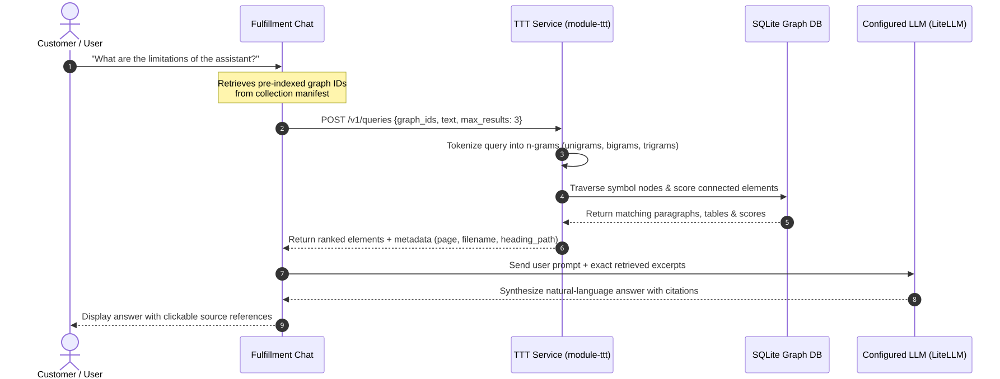

# Downstream Integration & Fulfillment Chat

[Docs home](README.md) › Fulfillment chat integration

This document details how external applications—such as conversational chatbots, enterprise agents, or search portals—integrate with TTT.

---

## 1. Fulfillment Chat Sequence Architecture

Fulfillment Chat demonstrates the recommended integration pattern connecting an external customer UI, TTT, and a conversational [LLM](https://en.wikipedia.org/wiki/Large_language_model):

<picture>
  <source media="(prefers-color-scheme: dark)" srcset="images/fulfillment-chat-with-ttt-dark.svg">
  
</picture>

<sub>Diagram source: [fulfillment-chat-with-ttt.mmd](diagrams/fulfillment-chat-with-ttt.mmd). Edit it and re-render with the steps in [docs/diagrams](diagrams/README.md).</sub>

---

## 2. Component Responsibilities

| Component | Responsibility |
|---|---|
| **Fulfillment Chat** | Manages user interface, conversation session history, authentication, and orchestrates calls between TTT and the LLM. |
| **TTT (`module-ttt`)** | Ingests documents, maintains section trees, builds symbolic index graphs, and retrieves grounded evidence with relevance scores. |
| **Language Model (LLM)** | Synthesizes a natural-language answer based strictly on retrieved excerpts. (Does not perform document indexing or search). |
| **Document Collection** | Source policy documents, user guides, or manuals uploaded and pre-indexed as stable graph IDs. |

---

## 3. Managing Document Collections

Documents should be **uploaded and indexed once**. Ingestion returns a permanent `result_graph_id`. Applications store these graph IDs in a configuration file or collection manifest rather than uploading files on every user query.

### Static Collection Manifest Example
See [`examples/fulfillment-collection.json`](../examples/fulfillment-collection.json):

```json
{
  "collection_name": "Fulfillment Knowledge Base",
  "documents": [
    {
      "name": "Fulfillment & Dispatch Policy",
      "filename": "fulfillment-policy.pdf",
      "graph_id": "graph::e1b4a7d290c8413f9a7218d6e35c8b01"
    },
    {
      "name": "Customer Returns & Refund Terms",
      "filename": "returns-policy.pdf",
      "graph_id": "graph::b49c017d83fa461298e1f0a25698dd34"
    }
  ]
}
```

---

## 4. Multi-Graph Querying

Queries can span multiple document graphs in a single API call:

```bash
curl -X POST "http://localhost:8090/v1/queries" \
  -H "Authorization: Bearer YOUR_API_KEY" \
  -H "Content-Type: application/json" \
  -d '{
    "graph_ids": [
      "graph::e1b4a7d290c8413f9a7218d6e35c8b01",
      "graph::b49c017d83fa461298e1f0a25698dd34"
    ],
    "text": "What is the return window for damaged items?",
    "max_results": 5,
    "summarize": false
  }'
```

---

**Related:** [API reference](api-reference.md) · [flowbot-chatbot-ttt, a working chat app on TTT](https://github.com/TalkingDB/flowbot-chatbot-ttt) · [sdk-talkingdb](https://github.com/TalkingDB/sdk-talkingdb) · [Retrieval and demonstrations](retrieval-and-demonstrations.md)
