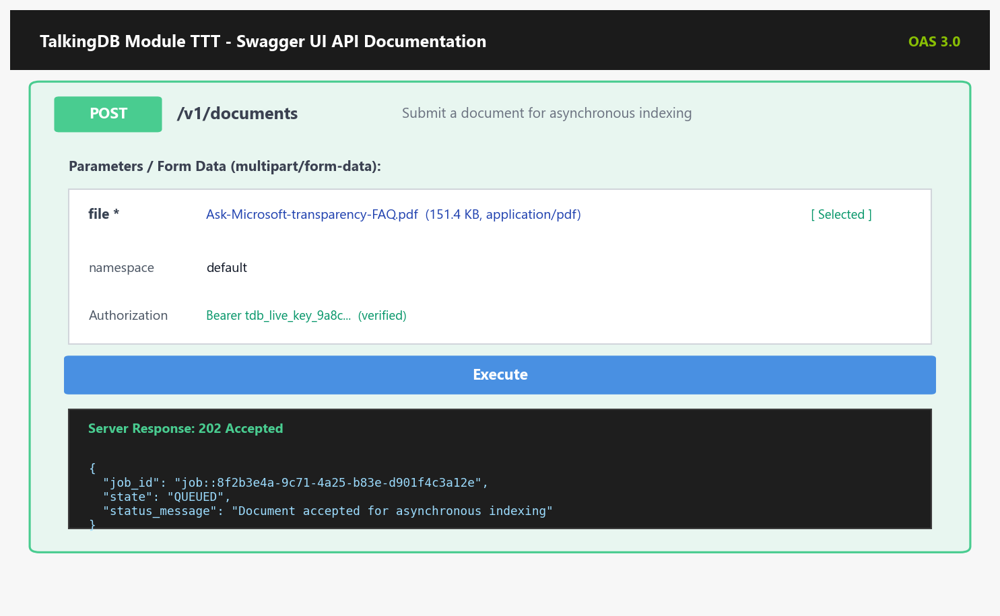
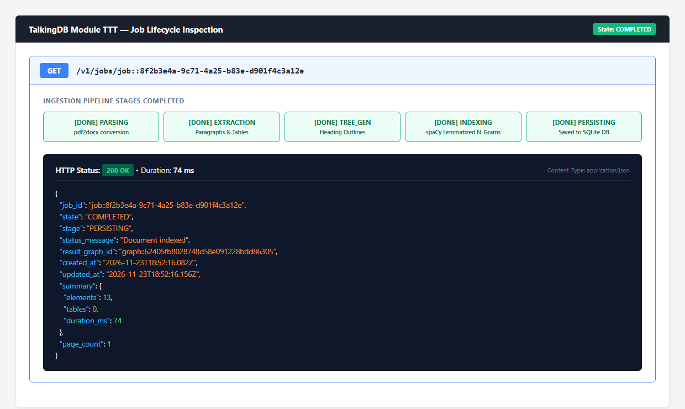

# Document Ingestion & Background Queue

[Docs home](README.md) › Ingestion pipeline

TTT processes documents asynchronously through a multi-stage background pipeline. This document details the upload constraints, worker queue configuration, and pipeline lifecycle stages.

---

## 1. Upload Constraints & Endpoints

Documents are submitted as `multipart/form-data` to the `/v1/documents` endpoint:

| Parameter | Type | Required | Description | Constraint |
|---|---|---|---|---|
| `file` | File Upload | Yes | Target document | `.pdf` (&le; 100 MB) or `.docx` (&le; 50 MB) |
| `namespace` | String | No | Tenancy partition | Default: `"default"` |

```bash
curl -X POST "http://localhost:8090/v1/documents" \
  -H "Authorization: Bearer YOUR_API_KEY" \
  -F "file=@sample-document.pdf"
```



### Response (`202 Accepted`)
```json
{
  "job_id": "job::8f2b3e4a-9c71-4a25-b83e-d901f4c3a12e",
  "state": "QUEUED",
  "status_message": "Document accepted for asynchronous indexing"
}
```

---

## 2. Queue Configuration & Concurrency

- **Queue Capacity:** Up to `QUEUE_CAPACITY` jobs can be admitted at once. It defaults to twice the number of workers (`TDB_JOB_QUEUE_CAPACITY`), and the number of workers defaults to the smaller of 4 and the machine's CPU count (`TDB_JOB_MAX_WORKERS`), both in [`app/core/config.py`](../app/core/config.py).
- **Rejection Behavior:** If the queue is saturated, `/v1/documents` returns `429 Too Many Requests`.
- **Worker Execution:** A dedicated worker background task (`app/services/jobs.py`) pulls jobs from the queue FIFO and processes each document through the 5 pipeline stages.

---

## 3. Pipeline Lifecycle Stages

Every document transitions sequentially through five deterministic processing stages:

<picture>
  <source media="(prefers-color-scheme: dark)" srcset="images/ttt-ingestion-stages-dark.svg">
  
</picture>

<sub>Diagram source: [ttt-ingestion-stages.mmd](diagrams/ttt-ingestion-stages.mmd). Edit it and re-render with the steps in [docs/diagrams](diagrams/README.md).</sub>

1. **`PARSING`**:
   - For PDFs: Converts PDF pages to internal DOCX flow using `pdf2docx` or parses layout primitives.
   - For DOCX: Reads document element tree directly using python-docx.
2. **`ELEMENT_EXTRACTION`**:
   - Invokes `package-content-elementizer` to extract headings, paragraphs, tables, rows, and cells.
   - Retains physical coordinates: page number, bounding layout, and reading order.
3. **`TREE_GENERATION`**:
   - Organizes sections and headings (H1 through H6) into a hierarchical outline tree (`FileIndexModel`).
   - Links paragraphs and tables to their immediate parent heading via directed `part_of` edges.
4. **`INDEXING`**:
   - [Tokenizes](https://spacy.io/usage/linguistic-features#tokenization) and [lemmatizes](https://en.wikipedia.org/wiki/Lemmatisation) text into unigrams, bigrams, and trigrams using [spaCy](https://spacy.io/usage/spacy-101) (`en_core_web_md`).
   - Applies `tokenize_structured` to tables to preserve numerical codes, years, and reference IDs.
   - Computes document-wide inverse document frequency ([IDF](https://en.wikipedia.org/wiki/Tf%E2%80%93idf)) weights.
5. **`PERSISTING`**:
   - Writes the constructed [NetworkX](https://networkx.org/documentation/stable/) directed graph into [SQLite](https://www.sqlite.org/about.html) (`data/graphs.db`).
   - Generates a permanent `result_graph_id` (e.g. `graph::62405fb8028748d58e091228bdd86305`).



---

## 4. Polling Job Progress

Clients track progress by polling `GET /v1/jobs/{job_id}`:

```bash
curl -X GET "http://localhost:8090/v1/jobs/job::8f2b3e4a-9c71-4a25-b83e-d901f4c3a12e" \
  -H "Authorization: Bearer YOUR_API_KEY"
```

### Completed Response (`200 OK`)
```json
{
  "job_id": "job::8f2b3e4a-9c71-4a25-b83e-d901f4c3a12e",
  "state": "COMPLETED",
  "stage": "PERSISTING",
  "status_message": "Document indexed",
  "result_graph_id": "graph::62405fb8028748d58e091228bdd86305",
  "summary": {
    "elements": 13,
    "tables": 0,
    "duration_ms": 74
  },
  "page_count": 1,
  "created_at": "2026-11-23T18:52:16.082Z",
  "updated_at": "2026-11-23T18:52:16.156Z"
}
```

---

## 5. Job Cancellation

An in-flight or queued job can be cancelled prior to completion:

```bash
curl -X POST "http://localhost:8090/v1/jobs/YOUR_JOB_ID/cancel" \
  -H "Authorization: Bearer YOUR_API_KEY"
```

If the job is still queued or running, TTT halts processing and marks the state as `CANCELLED`.

---

**Related:** [Concepts: jobs](concepts.md#jobs-from-upload-to-graph) · [Symbolic indexing](symbolic-indexing.md) · [Content elementizer](https://github.com/TalkingDB/package-content-elementizer) · [Troubleshooting: stuck jobs](troubleshooting.md#5-the-job-stays-queued-fails-or-does-not-complete)
