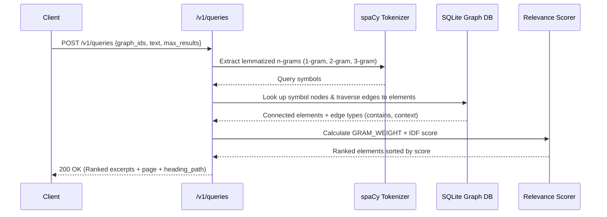
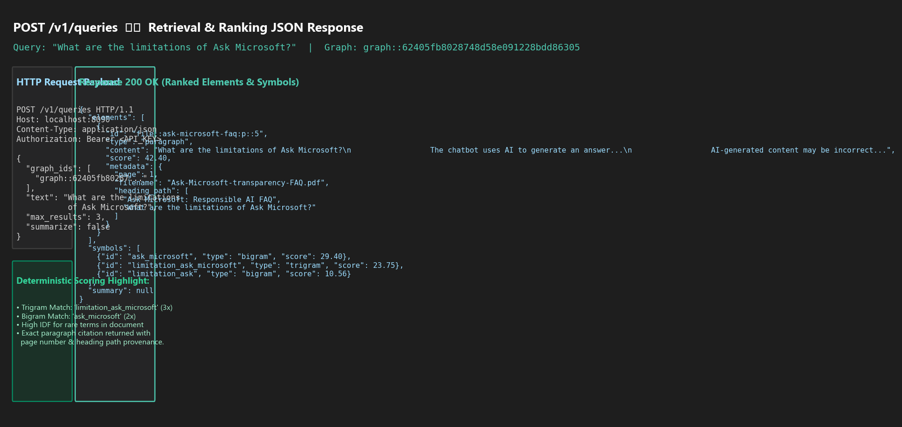

# Deterministic Retrieval & Real Demonstrations

This document presents actual input-to-output retrieval demonstrations run directly against real documents in this repository.

---

## 1. Retrieval Mechanism (`POST /v1/queries`)

Unlike vector similarity search (which computes cosine distance across embedding vectors), TTT performs **deterministic graph traversal**:



---

## 2. Real Document Demonstration: Paragraph Extraction

**Document:** [Ask-Microsoft-transparency-FAQ.pdf](../tests/load-tests/assets/Ask-Microsoft-transparency-FAQ.pdf) (151 KB)

### Query Request
```bash
curl -X POST "http://localhost:8090/v1/queries" \
  -H "Authorization: Bearer YOUR_API_KEY" \
  -H "Content-Type: application/json" \
  -d '{
    "graph_ids": ["graph::62405fb8028748d58e091228bdd86305"],
    "text": "What are the limitations of Ask Microsoft?",
    "max_results": 3,
    "summarize": false
  }'
```



### Actual Response (`200 OK`)
```json
{
  "elements": [
    {
      "id": "file::ask-microsoft-faq:p::5",
      "type": "paragraph",
      "score": 42.40,
      "content": "What are the limitations of Ask Microsoft? How can users minimize the impact of Ask Microsoft’s limitations when using the system? The chatbot uses AI to generate an answer for the user prompts. AI-generated content may be incorrect. Please make sure to read through the citation links provided along with the AI response or contact the sales team for more information by prompting “chat with sales”. The chatbot is primarily trained on English (U.S.) text. Any other language or English variations may not be accurate.",
      "metadata": {
        "page": 1,
        "filename": "Ask-Microsoft-transparency-FAQ.pdf",
        "heading_path": [
          "Ask Microsoft: Responsible AI FAQ",
          "What are the limitations of Ask Microsoft?"
        ]
      }
    }
  ],
  "symbols": [
    { "id": "ask_microsoft", "type": "bigram", "score": 29.40 },
    { "id": "limitation_ask_microsoft", "type": "trigram", "score": 23.75 },
    { "id": "limitation_ask", "type": "bigram", "score": 10.56 }
  ],
  "summary": null
}
```

### Analysis of Results
1. **Rank #1 Score (`42.40`):** The exact paragraph answering the query was retrieved with highest confidence.
2. **Grounded Provenance:** Includes physical location (`page: 1`) and hierarchical context (`heading_path: ["Ask Microsoft: Responsible AI FAQ", "What are the limitations..."]`).
3. **Symbol Attribution:** Shows exactly which symbols contributed to the score (`ask_microsoft`, `limitation_ask_microsoft`, `limitation_ask`), providing 100% auditability.

---

## 3. Optional LLM Summarization

When `"summarize": true` is passed, TTT executes a post-retrieval synthesis step via [LiteLLM](https://docs.litellm.ai/):

- **Input to LLM:** Only the top-ranked retrieved elements and their metadata.
- **Role of LLM:** The LLM does **not** search or index; it only synthesizes a natural language summary from the retrieved evidence.
- **Output:** Populates the `"summary"` field in the response JSON.
