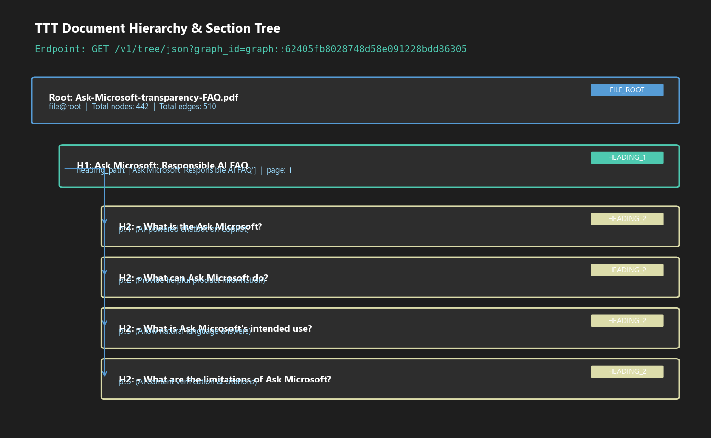

# Symbolic Indexing & Graph Construction

[Docs home](README.md) › Symbolic indexing

TTT replaces opaque, lossy vector [embeddings](https://en.wikipedia.org/wiki/Word_embedding) with **deterministic symbolic graph indexing**. This document explains the exact tokenization pipeline, [n-gram](https://en.wikipedia.org/wiki/N-gram) weights, edge relationship types, and relevance scoring mathematics.

---

## 1. N-Gram Symbol Generation

A [noun phrase](https://dictionary.cambridge.org/grammar/british-grammar/noun-phrases) in grammar is a word or phrase naming a person, place, or concept (e.g., `network access policy`). While indexed terms frequently look like noun phrases, **TTT does not execute a grammatical noun phrase parser**.

Instead, TTT implements **adjacent word n-gram indexing** with [spaCy](https://spacy.io/usage/linguistic-features#tokenization) [lemmatization](https://en.wikipedia.org/wiki/Lemmatisation):

```
"Network access policy controls customer authentication."
                           │
                           ▼
[1. Tokenization & Lemmatization] (app/services/package_text_tokenizer.py)
Tokens: ['network', 'access', 'policy', 'control', 'customer', 'authentication']
                           │
                           ▼
[2. N-Gram Symbol Generation] (app/services/package_symbol_generator.py)
```

| Symbol Type | Definition | Generated Example Symbols | Default weight (`GRAM_WEIGHTS`) |
|---|---|---|---|
| [Unigram](https://developers.google.com/machine-learning/glossary#n-gram) | Single normalized token | `network`, `access`, `policy`, `control`, `customer`, `authentication` | `1` |
| [Bigram](https://developers.google.com/machine-learning/glossary#bigram) | Two adjacent tokens | `network_access`, `access_policy`, `policy_control`, `control_customer`, `customer_authentication` | `4` |
| [Trigram](https://developers.google.com/machine-learning/glossary#trigram) | Three adjacent tokens | `network_access_policy`, `access_policy_control`, `policy_control_customer`, `control_customer_authentication` | `9` |

---

## 2. Linguistic Processing Steps

- **[Tokenization](https://spacy.io/usage/linguistic-features#tokenization):** Lowercases text, strips punctuation, and segments sentences into discrete word tokens.
- **[Lemmatization](https://spacy.io/usage/linguistic-features#lemmatization):** Maps inflected word variants to base dictionary headwords (e.g., `policies` &rarr; `policy`, `controls` &rarr; `control`).
- **[Stop Words Filtering](https://spacy.io/usage/linguistic-features#language-data):** Removes common functional words (`the`, `is`, `with`, `and`, `of`) from prose sentences so only content-carrying words form symbols.
- **Structured Tokenizer (`tokenize_structured`):** Special tokenizer for tables that preserves slashes, hyphens, numbers, and dates (e.g., `10/2025/01` &rarr; `10_2025_01`), enabling exact cell retrieval.

---

## 3. Directed Graph Topology

TTT builds an in-memory [NetworkX](https://networkx.org/documentation/stable/tutorial.html) directed graph for each document, which is subsequently serialized to [SQLite](https://www.sqlite.org/about.html).

<picture>
  <source media="(prefers-color-scheme: dark)" srcset="images/symbols-linked-to-a-paragraph-dark.svg">
  
</picture>

<sub>Diagram source: [symbols-linked-to-a-paragraph.mmd](diagrams/symbols-linked-to-a-paragraph.mmd). Edit it and re-render with the steps in [docs/diagrams](diagrams/README.md).</sub>

### Node Types
- `file@root`: Document root node containing global metadata (filename, page count).
- `heading`: Structural section node (H1 to H6) containing section title and level.
- `paragraph`: Text body element containing text runs and page coordinates.
- `table`: Table container element.
- `table_row`: Row container preserving row header and sequence.
- `table_cell`: Cell container preserving column header, row header, and raw value.
- `symbol`: Lemmatized unigram, bigram, or trigram token node.

### Edge Relationship Types
- `part_of`: Structural hierarchy edge connecting child elements to parent sections (e.g., cell to row, row to table, paragraph to heading).
- `contains`: Directed index edge connecting a symbol to an element where the symbol occurs directly in the text (weight `1.0`).
- `context`: Directed index edge connecting a symbol to an element where the symbol occurs in surrounding table or section context (weight `CONTEXT_MATCH_WEIGHT = 0.4`).


---

## 4. Relevance Scoring & IDF Mathematics

When a query is received:
1. The query text is tokenized and lemmatized into query unigrams, bigrams, and trigrams.
2. TTT matches query symbols against symbol nodes in the document graph.
3. For each matched symbol, TTT traverses incoming edges to connected document elements.

The element relevance score is calculated as:

```text
score(element) = sum, over every query symbol linked to the element, of
                 GRAM_WEIGHT(symbol) × IDF(symbol) × EDGE_WEIGHT(edge)

IDF(symbol)    = ln(1 + N / DF(symbol))
```

| Part | Meaning | Default |
| :--- | :--- | :--- |
| `GRAM_WEIGHT` | How much a match of this length counts | `9` trigram, `4` bigram, `1` unigram; set with `TDB_GRAM_WEIGHT_TRIGRAM`, `TDB_GRAM_WEIGHT_BIGRAM`, `TDB_GRAM_WEIGHT_UNIGRAM` ([`app/core/config.py`](../app/core/config.py)) |
| `EDGE_WEIGHT` | Direct match or match through context | `1.0` for `contains`, `0.4` for `context` (`TDB_CONTEXT_MATCH_WEIGHT`) |
| [`IDF`](https://en.wikipedia.org/wiki/Tf%E2%80%93idf#Inverse_document_frequency) | Inverse document frequency: rare symbols count more | `ln` is the natural logarithm |
| `N` | Elements in the document graph (paragraphs, tables, rows and cells) | |
| `DF` | Elements linked to the symbol by a direct `contains` edge; `context` edges do not count | |

**Worked example** (made up numbers, to show the arithmetic). A document has `N = 100` elements and a paragraph matches three query symbols directly:

| Symbol | Kind | DF | IDF = ln(1 + 100 / DF) | × GRAM_WEIGHT | Adds |
| :--- | :--- | ---: | ---: | ---: | ---: |
| `policy` | unigram | 40 | 1.253 | × 1 | 1.253 |
| `authentication` | unigram | 5 | 3.045 | × 1 | 3.045 |
| `customer_authentication` | bigram | 2 | 3.932 | × 4 | 15.727 |
| | | | | **Score** | **20.025** |

The common word `policy` adds little; the rare two word phrase adds most of the score.

Higher-order n-grams provide a deterministic multi-word phrase boost. Rare, distinctive terms receive higher IDF weights than generic terms.

---

## 5. Document Section Hierarchy Tree

Clients can retrieve the full hierarchical outline of a document via `GET /v1/tree/json?graph_id=YOUR_GRAPH_ID`:



The tree JSON preserves:
- Heading hierarchy (H1 &rarr; H2 &rarr; H3 &rarr; paragraphs).
- Provenance: File name, page number, and full `heading_path` breadcrumbs.

---

**Related:** [Concepts: symbols and scoring](concepts.md#symbols) · [Table extraction](table-extraction.md) · [Retrieval and demonstrations](retrieval-and-demonstrations.md) · [Troubleshooting: no useful matches](troubleshooting.md#6-a-query-returns-no-useful-matches)
