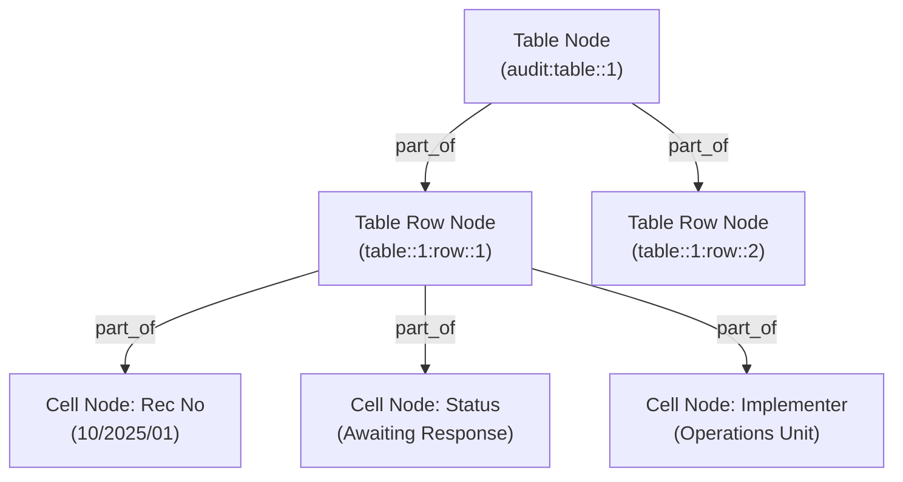
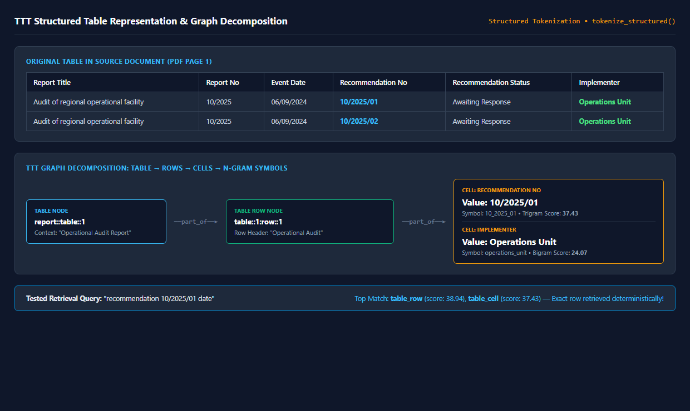

# Structured Table Extraction

Tables represent one of the most critical points of failure for conventional Retrieval-Augmented Generation (RAG) systems. This document explains how TTT decomposes multi-column tables into relational graph structures and demonstrates deterministic table retrieval.

---

## 1. The Table Problem in Conventional RAG

Standard embedding models treat documents as continuous streams of text. When a table is split into fixed-size chunks:
1. **Severed Column Bindings:** Column headers are separated from data cells further down the page.
2. **Broken Row Integrity:** Rows spanning chunk boundaries get split across vectors.
3. **Loss of Numerical Context:** Numbers like `$45,000` or `10/2025/01` lose their associated labels and column identifiers.

As a result, queries asking for a specific cell value (e.g., *"What is the status of recommendation 10/2025/01?"*) frequently fail or hallucinate wrong rows.

---

## 2. How TTT Decomposes Tables

TTT parses tables structurally into a 3-tier node hierarchy connected by `part_of` edges:

- **Table Node (`type: table`):** Represents the entire table container, capturing captions and surrounding section headers.
- **Table Row Node (`type: table_row`):** Groups all cells belonging to a single record, indexing the row header.
- **Table Cell Node (`type: table_cell`):** Retains:
  - Column header metadata (`col_header`)
  - Row header metadata (`row_header`)
  - Raw cell content and physical coordinates

---

## 3. Real Document Demonstration

**Document:** `operational-audit-index.pdf` (Multi-Column Compliance and Audit Index)

### Source Document Content vs. TTT Graph Representation

| Source Document Content | TTT Extracted Representation | Extracted Values from Test Document |
|---|---|---|
| **Table Title / Caption** | Table Node (`type: table`) | `Operational Audit Report Index` (`audit:table::1`) |
| **Column Headings** | Column Header Metadata | `Report Title`, `Report No`, `Event Date`, `Recommendation No`, `Recommendation Status`, `Implementer` |
| **Individual Data Rows** | Table Row Nodes (`type: table_row`) | Row 1: Audit of regional operational facility, report 10/2025 |
| **Individual Data Values** | Table Cell Nodes (`type: table_cell`) | `10/2025/01` (Rec No), `06/09/2024` (Date), `Operations Unit` (Implementer) |
| **Surrounding Section** | Heading Path & Context Metadata | Heading Path: `["Operational Audit Report Index"]` |
| **Source Location** | Page Metadata | `page: 1` |

---

## 4. Querying Extracted Tables

### Query 1: Broad Query across Column and Row Labels
- **Query:** `"operational audit recommendation Operations Unit"`
- **Top Matched Element:** `table_row` (score: `12.44`), `table_cell` (score: `11.34`).
- **Extracted Content:** `"Audit of regional operational facility | Implementer: Operations Unit"`
- **Matched Symbols:** `operations_unit` (bigram, `24.07`), `operational` (unigram, `9.28`), `audit` (unigram, `9.28`).

### Query 2: Exact Reference Code Retrieval
- **Query:** `"recommendation 10/2025/01 date"`
- **Top Matched Element:** `table_row` (score: `38.94`), `table_cell` (score: `37.43`).
- **Extracted Content:** `"Audit of regional operational facility | Recommendation No: 10/2025/01 | Event Date: 06/09/2024"`
- **Matched Symbols:** `10_2025_01` (trigram, `37.43`), `10_2025` (bigram, `28.90`), `2025_01` (bigram, `16.64`).

---

## 5. Why `tokenize_structured` Succeeds

Standard NLP tokenizers discard slashes, dashes, and punctuation, reducing `10/2025/01` to isolated tokens `10`, `2025`, `01`. 

TTT's `tokenize_structured` tokenizer:
1. Recognizes reference identifiers, codes, dates, and currency values.
2. Preserves the full token composite (`10_2025_01`).
3. Awards the highest trigram weight (`3.0`), ensuring exact cell and row retrieval without hallucination.
